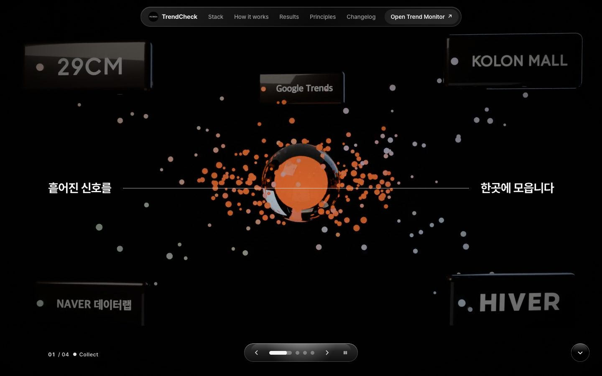
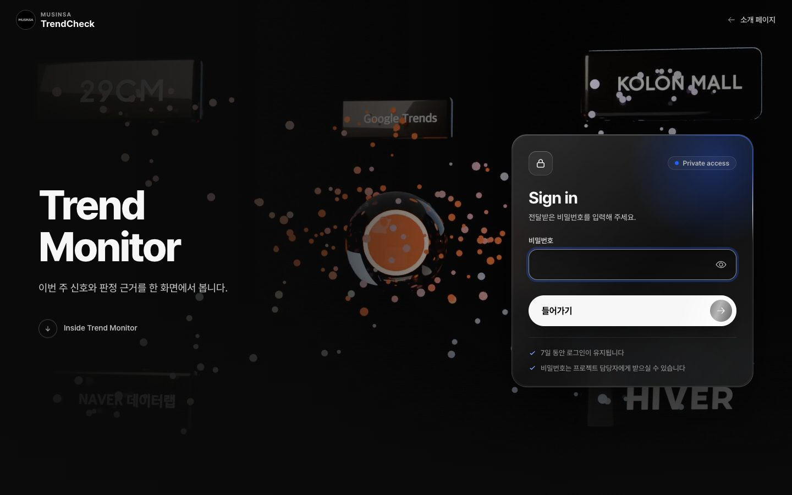
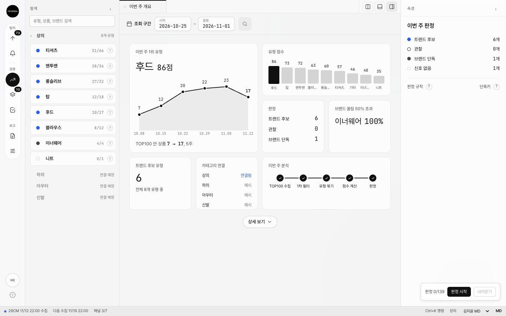
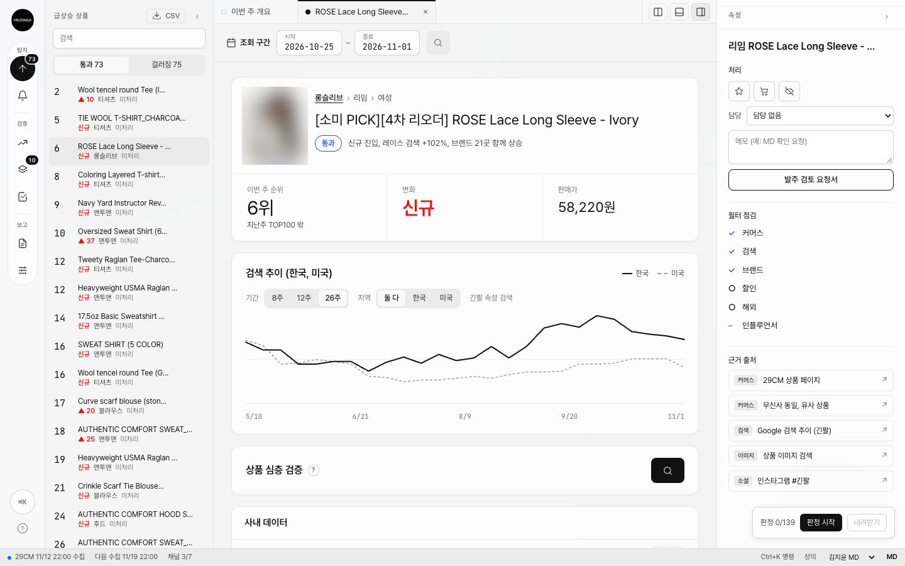
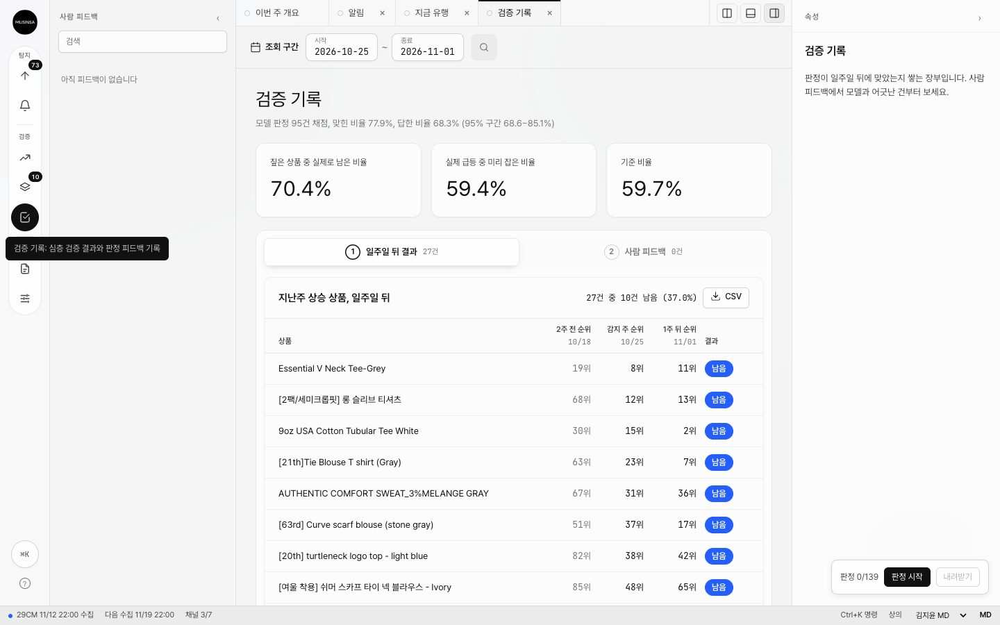
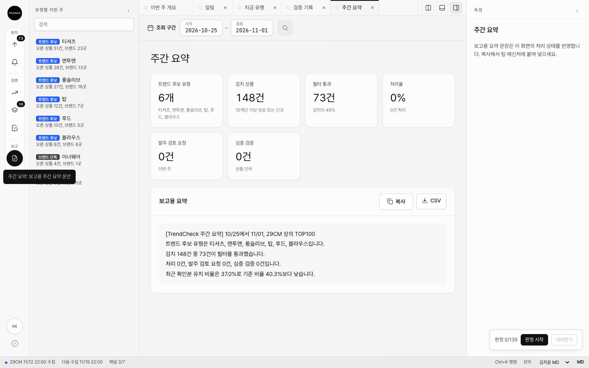

# Trend Monitor

**패션 신호를 모아, 반짝 유행인지 오래 갈 흐름인지를 과거 자료로 검증하는 시스템**

아주대학교 소프트웨어학과 2026-2학기 자기주도프로젝트, 산업체 연계 무신사

**웹 주소: https://trend-monitor.pages.dev**

소개 화면은 누구나 볼 수 있고, Trend Monitor 화면은 전달받은 비밀번호로 들어온다.
이 문서의 숫자는 2026-11-12 기준이다.



이 문서는 두 장으로 되어 있다.

- **1장**은 개발자가 아닌 분이 3분 안에 읽고 전체를 이해하도록 썼다.
- **2장**은 같은 내용을 자세히 풀었다. 구조, 자료, 판정 방법, 보안, 결과, 한계를 다룬다.
- 맨 뒤 **부록**은 코드를 직접 돌릴 개발자용이다.

---

# 1장. 3분 요약

## 한 문장으로

> 쇼핑몰 순위와 검색량을 매일 모아서, **"지금 오르는 이 상품이 일주일 뒤에도
> 버틸까"** 를 판정하고, 그 판정이 얼마나 맞는지를 정답을 가린 시험지로 채점한다.

## 왜 필요한가

순위가 오른 상품 가운데 상당수는 오래 가지 않는다. 할인, 광고, 한 브랜드의
기획전 때문에 잠깐 오른 것은 행사가 끝나면 내려온다. 반대로 여러 곳에서 함께
오르는 것은 실제 수요일 가능성이 높다.

문제는 **오른 그 순간에는 둘이 똑같아 보인다**는 것이다. 그래서 이 시스템은
두 가지를 한다.

1. 오른 상품을 여러 채널(검색, 다른 쇼핑몰)과 맞춰 보고 걸러 낸다.
2. "그때 이렇게 판정했다면 맞았을까" 를 과거 자료로 반복해서 채점해, **판정 방법
   자체를 숫자로 검증**한다.

## 어떻게 동작하나

```
 ① 모은다          29CM, 코오롱몰, 하이버 판매 순위 + 네이버, 구글 검색량
                   매일 오전 10시와 오후 10시 자동 수집
        ↓
 ② 거른다          오른 상품만 고른 뒤
                   "검색도 같이 올랐나", "한 브랜드만 오른 건 아닌가" 를 확인한다
        ↓
 ③ 판정한다        일주일 뒤에도 상승분의 절반 이상 남을지 예측한다
                   필요하면 AI(Claude)가 근거를 읽고 단계별 검증 보고서를 쓴다
        ↓
 ④ 채점한다        결과를 이미 아는 과거 사례로 판정을 채점한다
                   "아무렇게나 찍었을 때" 보다 나은지를 항상 함께 잰다
```

가장 중요한 원칙은 **미래를 보지 않는 것**이다. "11월 3일에 판정했다면" 을
재현할 때는 11월 3일까지 알 수 있던 자료만 쓴다. 그 뒤 자료가 한 건이라도
섞이면 시스템이 작업을 멈춘다.

## 화면에서 보는 것

[https://trend-monitor.pages.dev](https://trend-monitor.pages.dev) 에서 "Open Trend
Monitor" 를 누르고 비밀번호를 넣으면 Trend Monitor 화면이 열린다.



| 화면 | 보여 주는 것 | 갱신 |
| --- | --- | --- |
| Weekly overview | 이번 주 상의 유형(후드, 맨투맨 등)별 순위와 점수 | 매주 |
| Trends now | 카테고리를 넘어 공통으로 뜨는 속성(소재, 핏, 무늬) | 매주 |
| Rising items | 10계단 이상 오른 상품, 새로 들어온 상품, 거르기 결과 | 매주 |
| Verification log | 일주일 전 판정한 상품이 실제로 남았는지 | 매주 |
| Weekly brief | 보고용 요약 문장과 CSV 내려받기 | 매주 |
| 심층 검증 버튼 | AI 가 상품 하나를 단계별로 검증하고 보고서를 씀 | 누를 때마다 |

**이번 주 개요.** 1위 유형과 점수 추이, 유형별 점수, 이번 주 판정 개수를 한눈에 본다.



**상품 상세.** 급상승 상품 하나를 누르면 순위 변화, 한국과 미국의 검색 추이, 오른쪽의
필터 점검(커머스, 검색, 브랜드는 통과 여부, 할인과 해외는 참고 표시), 근거 출처가
나온다. 아래 "상품 심층 검증" 버튼이 AI 검증을 시작한다. (상품 사진은 판매자 사진이라
흐리게 처리했다)



**검증 기록.** 지난주에 오른 상품이 일주일 뒤에도 남았는지를 표로 쌓고, 모델 판정의
채점 결과를 위에 함께 보여 준다.



**주간 요약.** 이번 주 숫자를 보고용 문장으로 만들어 준다. 복사해서 메신저에 붙이거나
CSV 로 내려받는다.



## 지금까지의 결과

정답을 가린 시험지 139건으로 채점한 최신 결과(2026-11-03, 6차)다.

```
 AI 판정기가 답한 문항        95건 / 139건   (나머지 44건은 "판단 보류")
 답한 문항의 정확도            77.9%
 같은 문항을 전부 "내려간다"로
 찍었을 때의 정확도(기저율)     66.3%
 차이                          +11.6%p   통계적으로 우연이 아니라고 볼 수 있는 수준
```

**읽는 법.** 오른 상품의 대부분은 실제로 내려간다. 그래서 무조건 "내려간다" 고만
해도 66% 는 맞는다. 의미 있는 성과는 이 66% 를 얼마나 넘느냐다. 정확도만 따로
말하면 과장이 되므로 이 시스템은 항상 둘을 나란히 적는다.

**아직 조심할 점.** 수집을 시작한 지 두 달(2026-09-06 부터)이라 사례가 겹치는
기간에서 나왔다. 수집이 쌓일수록 숫자가 더 단단해진다. 자세한 한계는 2장 10절에
적었다.

## 알아 두면 좋은 말 다섯 개

| 말 | 뜻 |
| --- | --- |
| 채널 | 자료가 나오는 곳 하나. 예: 29CM 순위, 네이버 검색량 |
| 확인 시점 (T_cut) | "이날 판정했다면" 의 그날. 이후 자료는 쓰지 않는다 |
| 기저율 | 생각 없이 많은 쪽으로 찍었을 때의 정확도. 넘어야 할 최소 기준 |
| 판단 보류 (기권) | 근거가 모자라 답하지 않은 것. 틀린 것과 따로 센다 |
| 봉인 시험지 | 정답을 저장소에 두지 않은 시험지. 답을 보고 맞추는 일을 막는다 |

---

# 2장. 자세한 설명

## 1. 전체 구조

시스템은 다섯 덩어리다. 위에서 아래로 자료가 흐른다.

```
[1] 수집기                 사이트마다 하나씩. 형식은 달라도 같은 모양의 기록으로 바꾼다
     29CM  코오롱몰  하이버  네이버 데이터랩  네이버 쇼핑인사이트  구글 트렌드
        ↓
[2] 보관                   두 군데에 같은 내용을 쓴다
     CSV 스냅샷 (원본, GitHub 에 매일 올라감)   →   SQLite DB (CSV 로 언제든 다시 만듦)
        ↓
[3] 분석                   파이썬 프로그램
     속성 뽑기 (상품명 → 소재, 핏, 무늬)    순위 변화 계산    검색 흐름 비교
     거르기 5단계    지속 여부 정답 만들기    시험지 만들기 (미래 자료 차단)
        ↓
[4] 판정과 채점
     규칙 판정 (기준선)    AI 판정 (Claude)    채점 (기저율 대비, 보류 따로)
        ↓
[5] 웹 서비스              Cloudflare Pages
     소개 화면 (누구나)    로그인    Trend Monitor (승인된 분)    AI 중계 서버 (키 보관)
```

각 덩어리가 하는 일을 사람의 업무에 빗대면 이렇다.

| 덩어리 | 비유 | 실제 위치 |
| --- | --- | --- |
| 수집기 | 매일 매장을 돌며 순위표를 적어 오는 사람 | `src/trend_pipeline/collectors/` |
| 보관 | 적어 온 원본을 날짜별 서류철로 보관 | `data/snapshots/`, `data/trend.db` |
| 분석 | 서류철을 펼쳐 표를 만들고 이상한 것을 거름 | `src/trend_pipeline/`, `scripts/` |
| 판정과 채점 | 판단을 내리고, 지난 판단이 맞았는지 채점 | `scoring.py`, `review_cases.py` |
| 웹 서비스 | 결과를 보여 주는 창구와 출입문 | `design/`, `web/functions/` |

## 2. 자료를 어디서 모으나

| 채널 | 무엇을 | 왜 | 수집 시작 | 쌓인 기록 |
| --- | --- | --- | --- | --- |
| 29CM 판매 순위 | 순위, 가격, 할인율, 리뷰 수, 사진 | 무신사 계열 커머스의 대체 지표 | 2026-09-06 | 61,538 |
| 코오롱몰 베스트 | 순위, 좋아요 수, 자사 브랜드 여부 | 운영사가 다른 독립 쇼핑몰 | 2026-11-05 | 7,263 |
| 하이버 실시간 랭킹 | 순위, 브랜드 | 남성 패션 중심의 독립 쇼핑몰 | 2026-11-05 | 1,200 |
| 구글 트렌드 | 주간 검색 지수 (한국, 미국 등) | 검색 관심, 해외가 먼저인지 | 2021-12 부터 소급 | 84,874 |
| 네이버 쇼핑인사이트 | 분야별 클릭 지수, 성별 연령 분해 | 국내 쇼핑 관심과 고객층 | 2021-08 부터 소급 | 22,342 |
| 네이버 데이터랩 | 검색어 트렌드 | 국내 검색 관심 | 2021-08 부터 소급 | 4,380 |

합계 약 18만 건이다(2026-11-12 기준).

**쇼핑몰 순위는 그날 모으지 않으면 영원히 사라진다.** 순위는 "지금" 만 보여
주고 과거를 다시 보여 주지 않는다. 그래서 하루 두 번 빠짐없이 모은다. 반대로
검색량은 과거 구간을 나중에 조회할 수 있어서 몇 년치를 한 번에 받았다.

**29CM 와 무신사는 같은 계열로 본다.** 로그인과 주문 일부를 공유한다. 그래서
"두 곳에서 함께 올랐다" 를 셀 때 둘을 같은 곳으로 친다. 코오롱몰과 하이버는
운영사가 달라 독립된 곳으로 센다.

**무신사 랭킹은 수집하지 않는다.** robots.txt 가 허용된 수집기만 들이는
방식이라 저희 수집기는 막혀 있다. 규칙을 지키는 것이 원칙이라 우회하지 않는다.
각 사이트의 수집 규칙 확인 기록은 `docs/robots-compliance.md` 에 있다. 지그재그도
같은 이유로 뺐다.

**검색 지수는 절대량이 아니다.** 구글과 네이버는 "요청한 기간 안의 최댓값을 100"
으로 맞춘 상대값을 준다. 요청이 다르면 기준이 달라 직접 비교할 수 없다. 그래서
비교는 같은 요청 안에서만 하고, 새 주를 받을 때는 기간 전체를 다시 받아 통째로
바꾼다.

## 3. 모으고 보관하는 방법

```
매일 10:00, 22:00   쇼핑몰 세 곳 순위 수집 → CSV 와 DB 에 저장 → GitHub 에 올림
매시 17분           구글 트렌드를 8개 속성씩 갱신 (한 번에 많이 부르면 막힘)
```

수집은 팀원의 맥 컴퓨터에서 예약 작업으로 자동으로 돈다. 클라우드 서버에서 돌리지 않는 이유는
29CM 가 클라우드 서버의 접속을 막기 때문이다(2026-09 에 16번 모두 실패했다).

자료는 두 곳에 같이 쓴다.

- **CSV 스냅샷**(`data/snapshots/`)이 원본이다. 사람이 열어 볼 수 있는 표 파일이고
  매일 GitHub 에 올라가 기록이 남는다.
- **SQLite DB** 는 분석용 사본이다. 지워져도 CSV 에서 2초 만에 똑같이 다시 만든다.

같은 날 두 번 수집하면 두 번 모두 따로 남긴다. 한쪽이 중간에 실패해도 다른
쪽이 남아 그날 자료가 비지 않는다.

## 4. 미래를 보지 않는 장치

과거를 재현하는 실험에서 가장 흔한 실수는 **나중에 알게 된 정보가 몰래 섞이는
것**이다. 그러면 성적이 실제보다 좋게 나온다. 이를 막으려고 세 겹으로 지킨다.

1. **시각을 둘로 나눠 적는다.** 모든 기록에 "그 값이 가리키는 날(observed_at)" 과
   "우리가 가져온 날(collected_at)" 을 따로 적는다. 오늘 받은 작년 검색량은
   가져온 날은 오늘이지만 가리키는 날은 작년이다. 둘을 섞으면 걸러 낼 수 없다.
2. **문제지를 만들 때 자른다.** 확인 시점 이전 기록만 읽는다.
3. **내보내기 직전에 한 번 더 검사한다.** 확인 시점 이후 기록이 한 건이라도 있으면
   문제지 만들기를 통째로 멈춘다. 반쯤 섞인 문제지가 나가는 일이 없다.

정답(실제로 버텼는지)은 문제지와 다른 곳에 둔다. 판정하는 쪽은 정답을 볼 수 없다.

## 5. 후보를 거르는 다섯 단계

Rising items 화면은 순위가 오른 상품을 후보로 올린 뒤 다섯 가지를 확인한다.

| 단계 | 묻는 것 | 지금 상태 |
| --- | --- | --- |
| 검색 교차 | 같은 속성의 한국 검색도 올랐나 (최근 4주 평균 > 그 전 4주) | 거른다 |
| 브랜드 분산 | 한 브랜드만 오른 것은 아닌가 | 거른다 |
| 할인 효과 | 할인 때문에 오른 것은 아닌가 (지난주보다 5%p 이상 더 할인) | 표시만 한다 |
| 해외 선행 | 해외 검색이 한국보다 먼저 올랐나 | 표시만 한다 |
| 인플루언서 단발 | 한 사람 언급에 그친 것은 아닌가 | 자료가 아직 없다 |

"표시만 한다" 는 쟀지만 그것으로 탈락시키지 않는다는 뜻이다. 할인이 컸다고 꼭
반짝 유행인 것은 아니어서, 판단은 사람과 AI 에게 맡기고 사실만 보여 준다.

**속성은 상품명에서 뽑는다.** "오버핏 와플 헨리넥 긴팔 티셔츠" 에서 오버핏,
와플, 헨리넥, 긴팔을 찾는다. 속성 사전(`data/attributes.yml`)은 사람이 검수한다.
검색량은 상품이 아니라 이 속성 단위로 비교한다.

## 6. 판정: "왜 올랐나" 대신 "얼마나 버티나"

**질문을 바꾼 이유.** 순위가 왜 올랐는지(광고인지, 진짜 인기인지)는 쇼핑몰
내부 자료가 없으면 알 수 없다. 하지만 광고로 오른 순위는 광고가 끝나면 내려가고,
그건 밖에서도 보인다. 그래서 "일주일 뒤에도 남는가" 를 묻는다. 확인할 수 없던
질문이 확인할 수 있는 질문이 된다.

**정답은 사람이 정하지 않는다.** 정해진 공식으로 자료가 답한다.

```
기준 주   →   감지 주 (순위가 오름)   →   확인 주 (일주일 뒤)

오른 만큼의 절반 이상이 확인 주에도 남아 있으면  "지속"
그보다 많이 내려갔으면                            "소멸"
```

공식이 정해져 있어서 사례가 자동으로 쌓이고, 누가 다시 만들어도 같은 정답이
나온다. 실제로 다른 컴퓨터에서 처음부터 다시 만들어 같은 결과가 나오는지 지문
(해시)으로 확인한다.

**시험지는 세 종류다.** 성격이 달라 점수를 합치지 않는다.

| 시험지 | 무엇 | 건수 | 정답 공개 |
| --- | --- | --- | --- |
| benchmark | 29CM 순위가 일주일 버티는가 | 139 | 봉인 |
| benchmark-index | 한국 검색 지수가 4주 버티는가 | 207 | 봉인 |
| benchmark-index-long | 세 지역 검색 지수가 12주 버티는가 | 352 | 공개 (연습용) |

**채점 규칙 세 가지.**

1. 정확도는 항상 기저율과 함께 적는다. 찍기보다 나은지가 핵심이다.
2. 판단 보류는 틀린 것으로 세지 않는다. 대신 "얼마나 답했나(커버리지)" 를 함께
   적는다. 틀린 것으로 세면 신중한 판정이 벌을 받는다.
3. 기저율도 "답한 문항만" 으로 다시 계산한다. 쉬운 것만 골라 답하고 점수를
   올리는 꼼수를 막는다.

**봉인 시험지는 아껴 쓴다.** 볼 때마다 정답에 맞춰 고칠 위험이 커지므로 제출
횟수를 기록한다(`benchmark/submissions.tsv`). 지금까지 1회 제출했다.

## 7. AI 심층 검증

화면의 심층 검증 버튼을 누르면 Claude(Anthropic 의 AI)가 상품이나 유형 하나를
단계별로 검증하고 보고서를 쓴다.

- **AI 가 보는 것.** 그 주까지의 순위 흐름, 검색 흐름, 거르기 결과, 할인율 같은
  근거 숫자다. 이후 결과는 보지 않는다.
- **AI 가 내는 것.** 판정(지속, 소멸, 보류)과 그 이유, 반대 근거, 모르는 점이다.
  근거 번호를 달아 어떤 숫자를 보고 판단했는지 추적할 수 있다.
- **근거를 적는 말 한마디가 결과를 바꾼다.** 같은 자료에서 "결측" 이라고 적던 것을
  "TOP100 밖(그날 수집은 했지만 100위 안에 없었다)" 으로 고치자, AI 가 답한 비율이
  39% 에서 69% 로 올랐다. 자료는 한 글자도 바뀌지 않았다. 이 발견은 논문으로
  정리하고 있다(`docs/paper-and-release.md`).

**비용과 남용을 막는 장치.**

- AI 호출 열쇠(API 키)는 서버에만 있고 화면에는 내려가지 않는다.
- 평소에는 꺼 두고, 시연할 때만 정한 시간 동안 연다. 시간이 지나면 저절로 닫힌다.
- 서버가 요청 내용을 검사한다. 허용한 모델만, 답 길이 상한(4,000 토큰), 요청 크기
  상한(256KB)을 넘으면 자르거나 거절한다.

## 8. 웹 서비스와 보안

```
누구나          https://trend-monitor.pages.dev        소개 화면
                        ↓ "Open Trend Monitor"
비밀번호        /login                                  비밀번호 입력
                        ↓ 맞으면 7일짜리 입장권(쿠키)
승인된 분       /app                                    Trend Monitor
                        ↓ 심층 검증 버튼
서버            /api/complete                           키를 붙여 Claude 에 대신 요청
```

- **Cloudflare Pages** 에 올린다. 비용이 들지 않고, 서버에서 코드를 돌릴 수 있어
  키를 숨긴 채 AI 를 부를 수 있다. 다른 후보와 비교한 이유는 `docs/web-deploy.md`
  2절에 있다.
- **입장권은 위조할 수 없다.** 서버만 아는 비밀값으로 서명한다. 비밀번호를 틀리면
  잠깐 기다리게 해 마구 넣어 보는 시도를 늦춘다.
- **배포 전에 자동으로 검사한다.** 배포 폴더에 키 모양 글자나 비밀값 파일이 있으면
  배포를 멈춘다. 시험지 정답은 배포 폴더에 아예 복사하지 않는다.
- **자료는 매주 다시 굽는다.** 화면 안의 숫자는 그 주 DB 에서 뽑아 넣는다. 검색
  자료가 기준일까지 충분히 들어오지 않았으면 빌드를 멈춘다. 그대로 내보내면 거의
  모든 후보가 "검색 교차" 에서 걸러져 화면이 비어 보이기 때문이다.

## 9. 결과 자세히

**6차 채점 (봉인 시험지 139건, 2026-11-03)**

| 항목 | 값 |
| --- | --- |
| 답한 문항 | 95건 (커버리지 68.3%) |
| 정확도 | 77.9% (95% 신뢰구간 68.6% ~ 85.1%) |
| 기저율 (전체 / 답한 문항) | 59.7% / 66.3% |
| 기저율 대비 | +11.6%p |
| 우연이 아닌가 | 신뢰구간 아래끝 68.6% 가 기저율 66.3% 를 넘는다 |

**같은 시험지의 기준 전략**

| 전략 | 정확도 | 기저율 대비 |
| --- | --- | --- |
| 전부 "지속" | 40.3% | -19.4%p |
| 전부 "소멸" | 59.7% | 0 |
| 무작위 | 51.1% | -8.6%p |

앞선 61건 시험지(5차까지)에서는 사람이 손으로 짠 숫자 규칙도 돌려 봤다. 정확도
49.2% 로 찍기(54.1%)보다도 4.9%p 낮았다. AI 판정의 우위가 단순 규칙으로 되는
수준이 아니라는 근거가 된다.

**맞힌 방향.** 답한 95건 중 실제 소멸 63건 가운데 55건을, 실제 지속 32건 가운데
19건을 맞혔다. 소멸은 잘 잡고, 지속을 소멸로 보는 실수(13건)가 더 많다.

## 10. 한계와 앞으로 할 일

솔직하게 적는다.

- **표본이 아직 독립적이지 않다.** 수집 두 달 차라 사례들이 겹치는 기간에서
  나왔다. 신뢰구간은 사례가 서로 독립이라고 가정하므로 실제보다 좁게 나왔을 수
  있다. 수집이 쌓이면 해결된다. 가장 큰 숙제다.
- **한 번 돌린 결과다.** 같은 조건으로 여러 번 돌려 결과가 안정적인지 봐야 한다.
- **AI 모델 하나로만 봤다.** 다른 모델에서도 같은 경향이 나와야 일반적인 결론이다.
- **상의만 본다.** 수집은 하의, 아우터, 신발까지 하지만 분석 범위는 상의로 고정했다.
  범위를 실험 중간에 바꾸면 결과를 비교할 수 없기 때문이다.
- **무신사 자료가 없다.** 무신사 사이트는 외부 수집을 허용하지 않아 29CM, 코오롱몰,
  하이버로 대신한다.
- **인플루언서 단계는 비어 있다.** 언급 자료를 모을 방법을 아직 정하지 않았다.

## 11. 더 읽을 문서

| 문서 | 내용 |
| --- | --- |
| `docs/web-deploy.md` | 웹 배포 구조, 보안, AI 스위치 여닫기 |
| `docs/commerce-channels.md` | 쇼핑몰 채널을 셋으로 늘린 과정 |
| `docs/robots-compliance.md` | 사이트별 수집 규칙 확인 기록 |
| `docs/verification-handoff.md` | 판정 파트 인수인계 (무엇을 받고 무엇을 내나) |
| `docs/paper-and-release.md` | 논문 주제와 근거 |
| `DEMO.md` | 미팅 시연 대본 |

---

# 부록. 개발자용

## A. 디렉터리

```
src/trend_pipeline/          파이프라인 핵심
  models.py                  RawRecord. 모든 채널이 공유하는 기록 형식
  schema.sql, storage.py     SQLite 스키마와 저장
  snapshots.py               CSV 스냅샷 입출력
  collectors/                채널별 수집기 (cm29_rank, kolon_rank, hiver_rank,
                             gtrends, naver_datalab, naver_shopping)
  features.py                후보별 특징 (as_of 이전 자료만)
  persistence.py             지속성 사례와 정답 공식
  scoring.py                 채점 (기저율 대비, 보류 처리, 윌슨 구간)
  export.py                  사례 묶음 내보내기와 누수 검사
  demographics.py            성별 연령 쏠림 (분야 기준선 대비)
  embeddings.py, vectorstore.py, clustering.py   임베딩, 벡터 검색, 동의어 묶기
src/trend_poc/               월간 사례 실험과 AI 검토 호출
scripts/                     실행 진입점 (수집, 시험지, 채점, 화면 자료, 배포)
design/                      화면 원본 (Trend Monitor v9, 소개, 로그인)
web/functions/               Cloudflare 서버 함수 (비밀번호 게이트, AI 중계)
data/snapshots/              수집 원본 CSV (커밋 대상)
data/attributes.yml          속성 사전 (사람이 검수)
benchmark*/                  시험지 세 종 (봉인 정답은 저장소에 없다)
verification/                판정 결과 형식과 예시
tests/                       파이썬 시험 471개
```

모든 파이썬 함수와 서버 함수에 한국어 설명이 달려 있다. `design/runtime/` 의
부품과 `design/*.dc.html` 은 Claude Design 이 만든 파일이라 손대지 않는다.

## B. 설치와 실행

```
python3.12 -m venv .venv && source .venv/bin/activate
pip install -r requirements.txt
cp .env.example .env                        네이버 키 입력 (수집할 때만 필요)

python scripts/load_snapshots.py            CSV 에서 DB 복원 (약 18만 행, 2초)
python scripts/collect_daily.py             쇼핑몰 순위 수집
python scripts/collect_daily.py --status    채널별 누적 현황
python scripts/collect_gtrends.py           구글 트렌드 수집
python scripts/report.py                    터미널 보고서
./scripts/build_all_benchmarks.sh           시험지 세 종 다시 만들기
python scripts/score_verdicts.py --benchmark benchmark --baselines
python -m pytest tests -q                   시험
node web/functions/api/complete.test.mjs    AI 중계 시험
node web/functions/auth.test.mjs            비밀번호 게이트 시험
```

경로에 대괄호가 들어간 폴더(`[자주프]` 같은)에 두면 `pytest` 를 저장소 안에서
`tests` 경로를 지정해 돌린다.

## C. 다른 컴퓨터에서 이어서 하기

DB 는 저장소에 없다(90MB 바이너리). `data/snapshots` 의 CSV 가 원본이다.

```
git clone https://github.com/CalainKim/Trend_Verification_System
python scripts/load_snapshots.py
./scripts/build_all_benchmarks.sh
```

재생성한 `<시험지>/labels.digest.txt` 가 저장소의 값과 같으면 같은 자료로 같은
시험지가 만들어진 것이다. `.env` 와 `private/` 는 직접 옮긴다.

스냅샷 파일 단위는 채널마다 다르다. 순위는 관측일마다 한 파일, 검색 지수는 한
요청에 몇 년치가 오므로 연도마다 한 파일이다.

## D. 웹 배포

```
./scripts/build_web.sh                       최신 주로 build/web 생성
cd build/web && npx wrangler pages deploy . --project-name trend-monitor --branch main
./scripts/relay.sh open 2h                   AI 심층 검증 2시간 열기
./scripts/relay.sh close                     바로 닫기
```

배포는 반드시 `build/web` 안에서 돌린다. 바깥에서 돌리면 서버 함수가 빠진 채
올라가 심층 검증이 조용히 죽는다. 검색 자료 점검에 걸리면 `WEEK=<날짜>` 를 앞에
붙여 그 주로 만든다. 자세한 내용은 `docs/web-deploy.md`.

## E. 판정 파트가 시작하는 곳

```
1. docs/verification-handoff.md      무엇을 받고 무엇을 만드나
2. benchmark/cases/                  문제지 139건
3. verification/examples/            판정 출력 예시 3건과 읽는 법
4. benchmark-index-long/LABELS.md    혼자 채점하며 반복하는 방법
```

공개 시험지는 바로 채점된다.

```
python scripts/score_verdicts.py --benchmark benchmark-index-long --verdicts <판정 경로>
```

봉인 시험지는 판정을 묶어 수집 파트에 넘기면 채점해 돌려준다.

```
python scripts/score_verdicts.py --verdicts <판정 경로> --pack verdicts.json
```

## F. 월간 트렌드 검증 PoC

[설치와 실행 안내](docs/MONTHLY_POC.md), [세 아이템 실행 결과와 화면](docs/MONTHLY_POC_RESULTS.md)
