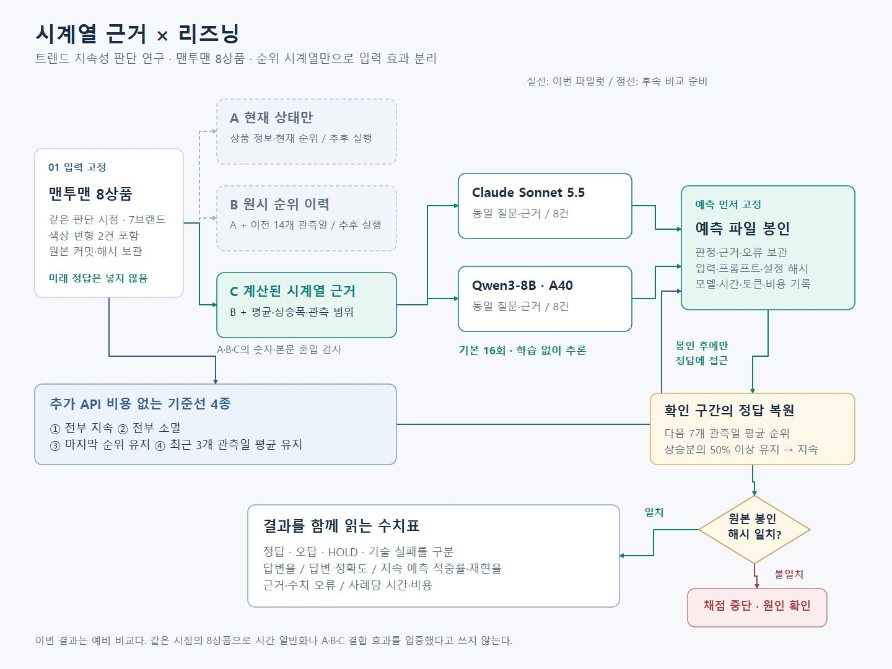

# 트렌드 추론 환경과 1차 입출력 스펙 점검

이번 주 목적은 **연구 환경을 준비하고, 기존 맨투맨 자료로 연결·입력·출력·저장 경로를 확인하며 1차 스펙을 정리하는 것**이다. 정식 연구 질문, 비교 설계, 성능 판단과 논문 방향은 이후 결정한다.

[초안 PR #18](https://github.com/CalainKim/Trend_Verification_System/pull/18) · [노션 작업 페이지](https://app.notion.com/p/4127af36aa5f809caee6d16cb8f4b6d1)

Claude와 A40 Qwen을 각 8회 연결해 응답 형식·저장을 확인했다. 그러나 **Qwen의 HOLD 7건은 모두 미래 확인값 부재를 이유로 들었고, 유일한 WATCH는 평가 문턱을 미래 평균처럼 사용했다.** 예측 지시는 있었지만 예측 과제와 사후 확인, HOLD 허용 조건의 경계가 충분히 전달됐는지 먼저 점검해야 한다. 정상 응답 수신을 의도한 예측 수행의 성공으로 간주하지 않는다.

| 구분 | 현재 상태 |
|---|---|
| 실행 환경 | Claude API·A40 Qwen3-8B 연결, 실행 설정·비용 기록, GPU 중지 확인 완료 |
| 1차 구현 | 순위 입력 구성, 구조화된 출력, 실행 기록과 해시 검증 구현 |
| 입출력 스펙 | 예측/HOLD/평가 문턱 구분을 보완할 항목 확인 |
| 연구 설계 | 기존 제안은 후보 초안으로 보관. 정식 비교와 논문 결론 미확정 |

| 문서 | 내용 |
|---|---|
| [Qwen 원인 점검](QWEN_PROMPT_DIAGNOSIS.md) | 실제 프롬프트·8건 출력·전송 경로 대조, 확인 사실과 가설 |
| [실제 프롬프트 사본](pilot-prompt-v1.json) | 봉인된 요청 문자열과 사례별 진단 자료 |
| [실행 안내](RUNBOOK.md) | 재현 가능한 준비·실행·저장·검증 경로 |
| [실행·진단 기록](RESULTS.md) | 환경 점검, 기존 집계 수치, 비용과 제한 사항 |
| [기존 설정·연구 설계 후보](PROTOCOL.md) | 실행 설정의 재현 기록과 미확정 연구 방향 |
| [논문 구성 메모](PAPER_DRAFT.md) | 이후 논의할 후보 구조; 현재 성과나 결론이 아님 |
| [출력 근거 점검](EVIDENCE_AUDIT.md) | 실제 입력과 출력의 수치·해석 대조 |
| [편집 가능한 draw.io](research-flow.drawio) | 이번 파일럿 구현의 실행 흐름; 최종 연구 설계는 아님 |

입력은 기준 커밋 `6fc299003000`의 공개 사례를 고정했다. `data/research/sweatshirt-v1.json`이 대상과 입력 해시의 기준이다. API 키·접속 정보·전체 실행 기록·복원한 정답은 `private/`에 보관한다. [기존 최종 출력](pilot-predictions.json), [집계 채점](pilot-scorecard.json), [비용 기록](pilot-costs.json)은 재현 기록으로 유지한다.

원인 점검에서 원본 프롬프트·예측·수치를 바꾸거나 모델을 추가 호출하지 않았다. 현재 문서는 수정 프롬프트의 효과를 주장하지 않는다.
