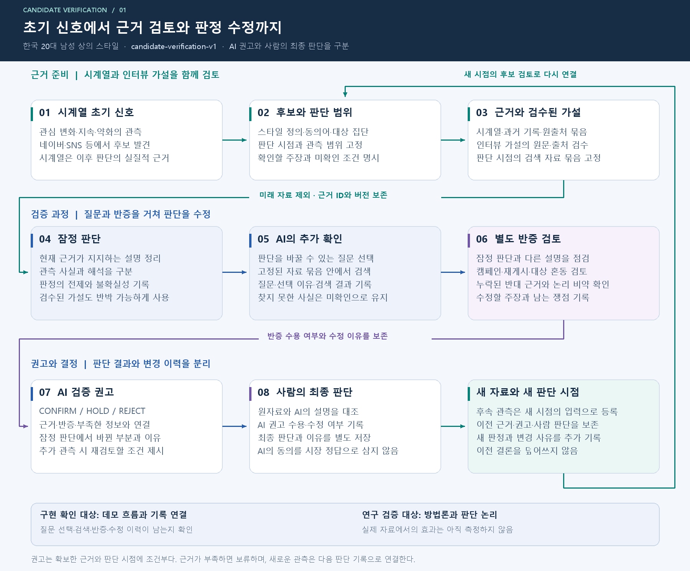
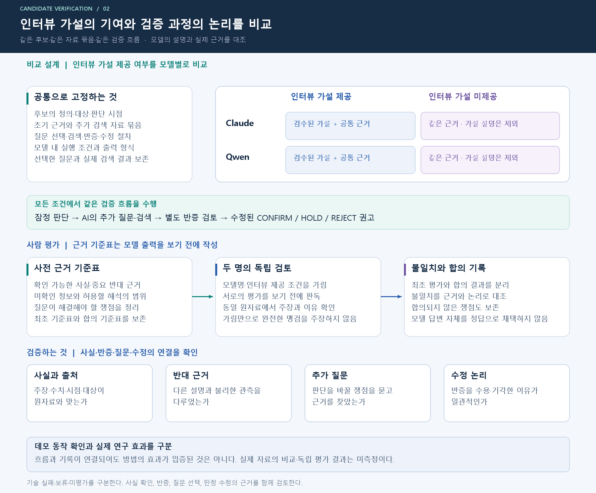

# 인터뷰 가설과 제한된 근거 조사를 결합한 패션 트렌드 후보 검증

교수님 검토용 초안 · 2026-11-12 · `candidate-verification-v1`

## 초록

시계열의 관심 변화는 조사할 후보를 보여 주지만, 그 후보를 트렌드 후보로 채택할 근거가 충분한지까지 설명하지는 않는다. 대상 집단의 차이, 관심과 실제 채택의 차이, 반복 홍보, 계절성 등 대안 설명을 당시 자료와 함께 확인해야 한다. 본 연구는 한국 20대 남성의 상의 스타일 키워드를 대상으로, 인터뷰에서 정리한 검토 가설과 동결된 자료집을 이용해 AI가 추가 조사와 별도 반증을 수행하고 확정·보류·기각을 제안하는 방법을 설계한다. 최종 결정은 사람이 하며 미래 유행 여부를 현재 판정의 정답으로 삼지 않는다. 같은 조사 절차에서 인터뷰 가설의 제공 유무를 비교하고, 모델을 달리했을 때 나타나는 근거 해석과 논리 오류를 살핀다. 두 평가자가 출력 확인 전에 사실·반대 근거·미확인 정보를 표시하고, 조건을 가린 최종 설명을 독립적으로 판독한다. 본 초안의 현재 성과는 방법·실행 계약·평가 양식과 합성 진단 구현의 준비다. 새 실제 자료의 본 비교 결과는 아직 없다.

**핵심어:** 트렌드 후보 검증, 근거 조사, 인터뷰 가설, 반증 검토, 판단 논리

## 1. 문제 정의

패션 상품·스타일에 대한 관심이 늘었다고 해서 목표 집단에서 독립적인 채택이 확산했다고 단정할 수 없다. 검토자는 왜 관심이 늘었는지, 어떤 집단의 반응인지, 반대 설명을 확인할 자료가 무엇인지 결정해야 한다. 초기 시계열 탐지 이후의 이 검증 과정이 본 연구의 대상이다.

사용자가 제공한 전사문에는 대상 집단별 차이, 검색과 구매의 괴리, 미디어 노출과 바이럴, 계절적 필요, 일상 착용 수용성에 관한 탐색적 논의가 있다. 발화자와 전사의 정확성이 확정되지 않아 이를 기업 요구사항이나 사실 명제로 인용하지 않는다. 연구자가 정리한 가설을 사람이 원문과 대조하고, 후보마다 당시 근거로 다시 확인하는 절차를 둔다. [가설 도출 기록](INTERVIEW_HYPOTHESES.md)

원래 프로젝트는 후보를 확정하거나 기각하는 검증 시스템을 지향했고, 인수인계 문서는 근거 추적과 별도 반증, 사람의 최종 판단을 강조했다. 본 방법은 이를 조사 단계와 판정 제안 단계로 구체화한다. 이전의 관찰 우선순위 설계나 상품 순위 지속성 실험과는 과제 버전과 결과를 분리한다. [초기 취지 대조](ALIGNMENT.md)

### 연구 질문

| 질문 | 관찰할 차이 |
|---|---|
| RQ1. 같은 자료집과 조사 절차에서 인터뷰 검토 가설을 주면 근거 충실성과 논리적 타당성이 달라지는가? | 사실 주장 지원, 근거 없는 도약·범위 혼동, 판정 설명의 적절성 |
| RQ2. 인터뷰 가설이 중요한 반대 근거의 발견·반영과 불확실성 처리를 어떻게 바꾸는가? | 질의와 획득 근거, 반대 근거의 누락·왜곡, 보류 사유, 별도 반증 뒤의 수정 |
| RQ3. 이러한 동작과 오류 유형은 서로 다른 모델에서 어떻게 나타나는가? | 모델 내 인터뷰 유무 차이를 먼저 비교한 뒤 공통·상이한 실패 유형 설명 |

연구의 중심은 인터뷰 가설을 이용한 **조사와 판단 방법의 검증**이다. 모델 순위, 임의 종합 점수, 실제 유행을 맞혔다는 주장을 목표로 두지 않는다. 시계열 신호와 인터뷰 기준을 결합했다는 사실만으로 새로운 기여라고 주장하지 않으며, 평가 가능한 절차와 실제 관찰된 한계를 기여 후보로 둔다.

## 2. 관련 연구

ALCE는 근거를 검색하고 인용을 포함한 답변을 생성하는 시스템에서 정확성과 인용 품질을 구분해 평가한다. 본 연구도 인용 ID가 존재하는지에 대한 기계 검사를, 인용 내용이 주장을 뒷받침하는지에 대한 사람 평가와 구분한다. ALCE 점수를 재현하거나 그 결과를 우리 과제에 그대로 적용하는 것은 아니다. [Gao et al., 2023](https://aclanthology.org/2023.emnlp-main.398/)

ReAct는 언어 모델의 작업 수행과 외부 정보 접근을 연결하는 방법을 제안했다. 본 연구의 AI도 부족한 정보에 맞춰 검색 질문을 만들지만, 통제된 후보별 자료집과 제한된 검색 횟수만 사용한다. 공개 기록은 질문·근거·수정 이유이며 내부 사고 과정의 공개나 충실성을 요구하지 않는다. [Yao et al., 2023](https://arxiv.org/abs/2210.03629)

Turpin 등은 모델 설명이 실제 답변에 영향을 준 요인을 충실히 드러내지 않을 수 있음을 보였다. 따라서 본 연구는 설명의 길이나 추론 모드로 내부 리즈닝의 정확성을 판단하지 않고, 외부에서 확인 가능한 주장과 근거의 관계, 공개된 판정 이유의 일관성을 검증한다. [Turpin et al., 2023](https://arxiv.org/abs/2305.04388)

## 3. 자료와 연구 단위

평가 사례는 스타일 키워드·대상 집단·판단 시점·후보 가설·자료집의 조합이다. 목표 집단은 한국 20~29세 남성이며 실제 관측 범위가 다르면 그 차이를 그대로 표시한다. 네이버 검색 연령 코드 `3+4`는 19~29세이므로 정확한 20~29세 관측으로 표시하지 않는다. 검색·쇼핑 클릭을 구매량으로 표현하지 않는다. [검색 API](https://developers.naver.com/docs/serviceapi/datalab/search/search.md), [쇼핑인사이트 API](https://developers.naver.com/docs/serviceapi/datalab/shopping/shopping.md)

본 비교는 새로운 후보 6건을 별도로 선정·고정하는 계획이다. 후보 선정 기준, 제외 사유, 판단 시점, 초기 시계열 신호와 대상 범위를 결과 확인 전에 기록한다. 선택한 사례가 모두 성공한 스타일이 되도록 사후 선별하지 않는다. 동의어·색상 변형·같은 캠페인을 별개 독립 사례로 늘리지 않는다. 현재 실제 후보 목록과 자료집은 아직 수집·동결되지 않았다.

자료집에는 원문 URL·발췌 위치·원생산자·관측 및 발표 시점·수집 시점·대상·지표 단위를 보존한다. 판단 시점 이후 정보와 당시 가용성을 보장할 수 없는 자료를 전향 입력처럼 사용하지 않는다. 인터뷰 가설·사람 평가 라벨·다른 모델의 답변은 검색 자료집에서 제외한다. 재게시 관계와 서로 다른 시점 관측은 구분한다.

맨투맨 8상품은 이전 환경·지시 수행 점검 기록이다. 헨리넥·럭비티·링거티는 과거 자료의 설명 사례다. 로컬 합성 예제는 계약·실패 처리 진단이다. 모두 새 실제 후보의 평가 결과와 합산하지 않는다. [자료 출처와 사용 경계](SOURCES.md)

## 4. 제안 방법

시계열 트리거가 후보를 등록하면 사람은 정의·시점·대상과 자료집을 고정한다. 인터뷰 제공 조건에서는 검토된 가설이 조사 질문의 출발점이 된다. AI는 초기 판단에서 자료 공백을 찾고, 동결된 자료집 안에서 추가 검색을 수행한다. 적어도 한 검색은 반대 근거·대안 설명을 찾는다. 이후 별도 요청의 반증 단계가 조사 결과와 잠정 판정을 검토하고, 최종 단계가 유지·수정 이유를 포함한 판정을 제안한다.

한 실행의 검색 한도는 최대 2회, 질의별 상위 3건이다. 두 조건에서 검색기·자료집·한도는 같지만 선택한 질문과 얻은 근거는 달라질 수 있다. 따라서 관찰되는 차이는 **인터뷰 가설로 안내한 조사와 판단 전체의 차이**다. 근거가 완전히 동일한 상태의 순수 추론 효과로 좁혀 주장하지 않는다.

최종 판정은 현재 근거에서 후보 가설을 채택할 `CONFIRM`, 핵심 정보 부족·충돌의 `HOLD`, 구체적 반대 근거에 따른 `REJECT`다. 미래값이 없다는 이유만으로 보류하지 않으며 광고의 존재만으로 기각하지 않는다. 사람은 모델의 제안을 수용하거나 바꾸고 이유를 기록한다. 이 최종 결정도 시장의 미래 정답은 아니다.

## 5. 평가 설계

### 통제된 비교

Claude와 Qwen 각각에 인터뷰 가설 제공·미제공 조건을 적용한다. 후보 6건 × 모델 2개 × 조건 2개로 계획된 최종 출력은 24건이다. **이는 API 호출 수가 아니다.** 각 실행에는 초기 판단·질의 계획·별도 반증·최종 제안 단계가 존재한다. 이번 구현 작업에서는 실제 모델 본 비교를 실행하지 않는다.

초기 근거, 동결 자료집, 조사·반증 흐름, 출력의 공통 필드와 모델 내 생성 설정을 고정한다. 인터뷰 미제공 조건의 모든 단계에는 가설·ID·적용 양식·다른 조건의 이력을 넣지 않는다. 실행 순서는 조건과 모델이 특정 사례 순서에 몰리지 않도록 사전에 배정하고 기록한다. [상세 계약](SPEC.md)

### 사람 평가와 지표

응도와 도은이 출력 확인 전에 전체 동결 자료집에서 사실, 판정에 중요한 반대 근거, 미확인 정보의 기준표를 각각 작성한다. 최초 기록을 보존한 뒤 합의 기준표를 고정한다. 모델명과 인터뷰 조건을 가린 최종 공통 필드를 독립 판독하고, 불일치와 사후 합의를 따로 남긴다. 인터뷰 제공 조건만 갖는 가설 적용표는 주평가에서 가리고 독립 평가 확정 뒤 진단한다. 표현에서 조건을 추측할 수 있는 한계는 남는다.

| 주 평가 항목 | 질문 |
|---|---|
| 출력 근거 충실성 | 모든 사실 주장과 수치·대상·기간이 실제로 제공된 근거에 의해 뒷받침되는가? |
| 논리적 타당성 | 공개된 전제 → 해석 → 판정에 도약·자기모순·순환논증·범위 이동이 없는가? |
| 반대 근거 처리 | 기준표의 중요한 반대 근거를 발견하고 정확히 반영했는가? |
| 판정·보류 적절성 | 판정 이유와 불확실성, 추가 확인 조건이 제공된 근거와 일치하는가? |
| 전체 처리와 평가 일치 | 모든 판정·기술 실패·미평가를 포함했는가? 합의 전 평가자 일치도는 어떠한가? |

검색되지 않은 중요 반대 근거는 조사 단계의 누락, 검색되었지만 반영하지 않은 근거는 해석 단계의 누락으로 구분한다. 반증 전후 변화는 수정 기록으로 설명하되, 별도 반증을 제거한 비교군이 없으므로 반증의 인과 효과로 주장하지 않는다. 모든 비율에 분자·분모와 미완료 수를 병기한다. [평가 명세](EVALUATION.md)

## 6. 현재 구현과 검증 상태

새 과제의 구현 경로는 `src/trend_verification_v1`, 실행 진입점은 `scripts/run_candidate_verification.py`다. 단계·검색·근거 ID·수정 기록을 저장하고 저장된 결과를 로컬 화면에서 확인하도록 분리한다. 합성 예제와 설정 점검은 실제 모델의 근거 해석 품질 검증과 다르다. 현재 실행 범위와 검사는 [구현 안내](IMPLEMENTATION.md)에서 확인한다.

새 실제 사례의 결과표는 다음과 같이 비워 둔다. 이전 Qwen 점검이나 합성 출력을 채워 넣지 않는다.

| 모델·조건 | 본 평가 상태 | 근거 충실성 | 논리적 타당성 | 반대 근거 처리 | 판정·실패 분포 |
|---|---|---|---|---|---|
| Claude · 인터뷰 제공 | 미실행 | 미측정 | 미측정 | 미측정 | 미측정 |
| Claude · 인터뷰 미제공 | 미실행 | 미측정 | 미측정 | 미측정 | 미측정 |
| Qwen · 인터뷰 제공 | 미실행 | 미측정 | 미측정 | 미측정 | 미측정 |
| Qwen · 인터뷰 미제공 | 미실행 | 미측정 | 미측정 | 미측정 | 미측정 |

## 7. 한계와 후속 연구

전사문에서 정리한 가설은 아직 사람의 해석 검토가 필요하고 대표 표본의 조사 결과가 아니다. 자료집 구성자의 선택 편향, 자동 검색이 중요한 근거를 놓칠 가능성, 소수 후보의 의존성, 같은 모델의 반증 한계, 두 평가자의 주관과 가림의 한계가 남는다. 인터뷰 제공 조건은 입력이 추가되므로 모든 차이를 인터뷰의 정확한 내용 하나로 환원할 수도 없다.

본 단계는 예비 방법 검증이며 유의한 우위나 시간·시장 일반화를 약속하지 않는다. 새로운 시점·스타일·자료집에서 같은 절차를 반복해야 범위를 넓힐 수 있다. 미래 반응은 판정 종류와 관계없이 별도로 추적하되, 임의 기간 안에 유행하지 않았다는 이유로 현재의 근거 해석을 자동 오답 처리하지 않는다. 실제 제품 의사결정의 개선은 별도 사용자 연구가 필요하다.
