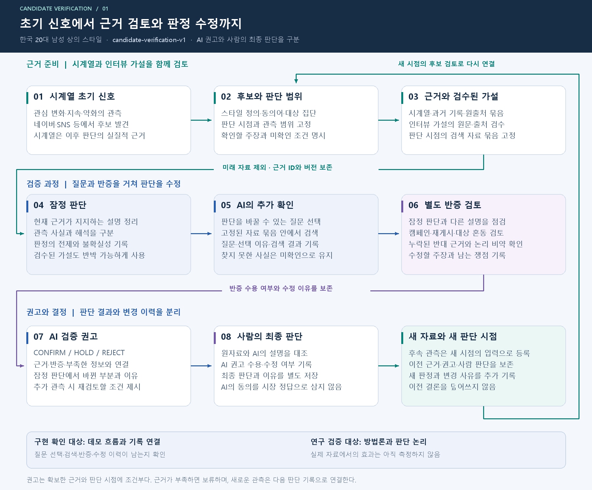
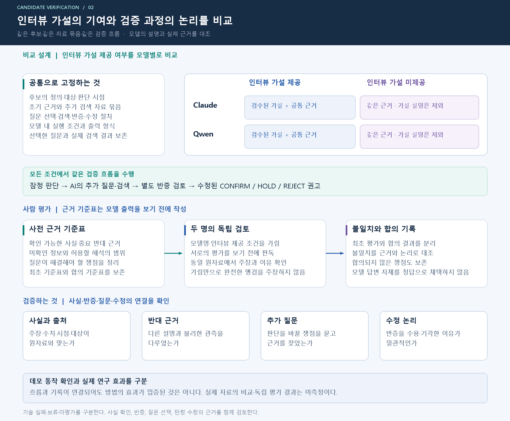

# 인터뷰 가설과 근거 조사를 결합한 트렌드 후보 검증

2026-11-12 · 현재 과제 `candidate-verification-v1`

**시계열에서 초기 후보를 찾고, AI가 인터뷰에서 정리한 검토 가설과 당시 자료를 이용해 조사·반증한 뒤 확정·보류·기각을 제안한다. 최종 결정은 사람이 한다.** 여기서 확정은 현재 후보 가설을 근거상 채택하는 뜻이며 미래 유행의 확정 예측이 아니다.

| 읽을 문서 | 목적 |
|---|---|
| [교수님 검토용 초안](PAPER_DRAFT.md) | 연구 문제, 제안 방법, 평가 설계와 주장 범위 |
| [원래 취지와 변경점](ALIGNMENT.md) | 최초 요청·GitHub 인수인계와 현재 설계의 관계 |
| [시스템·판정 계약](SPEC.md) | 조사 한도, 별도 반증, 판정과 기록의 의미 |
| [인터뷰 가설 초안](INTERVIEW_HYPOTHESES.md) | 원문에서 정리한 검토 질문과 사람 검토 절차 |
| [평가 명세](EVALUATION.md) | 인터뷰 유무 비교, 근거·논리 검증, 가림 평가와 분모 |
| [사람 평가표](forms/WORKSHEETS.md) | 원자료 기준표, 독립 판독, 합의, 사람 최종 결정 |
| [구현과 실행 안내](IMPLEMENTATION.md) | 로컬 합성 데모, 저장 기록, 실제 실험 준비의 구분 |
| [실제 모델 동작 점검](LIVE_CHECK.md) | 기존 링거티 자료의 실제 출력·실패, 프롬프트 계약의 개선점 |
| [출처와 자료의 경계](SOURCES.md) | 전사문·초기 요청·문헌·과거 실험의 사용 범위 |

[편집 가능한 draw.io](diagrams/candidate-verification-v1.drawio)

공개 합성 예제와 별도로 기존 링거티 실제 관측을 이용한 [모델 동작 점검](LIVE_CHECK.md)을 실행했다. 인터뷰 제공 조건은 필수 중첩 출력 계약을 충족하지 못해 전체 절차를 완료하지 못했다. 새로운 실제 후보의 선정·수집·동결, 사람의 인터뷰 해석 검토, 모델 본 비교와 독립 평가는 아직 수행하지 않았다. 실제 모델을 호출하거나 구현이 실행됐다는 사실을 방법론의 효과로 보고하지 않는다. 이전 [관찰 우선순위 설계](../priority-v1/PAPER_DRAFT.md)와 [상품 순위 파일럿](../FORECAST_V2_RESULTS.md)은 별도 버전으로 보존한다.
