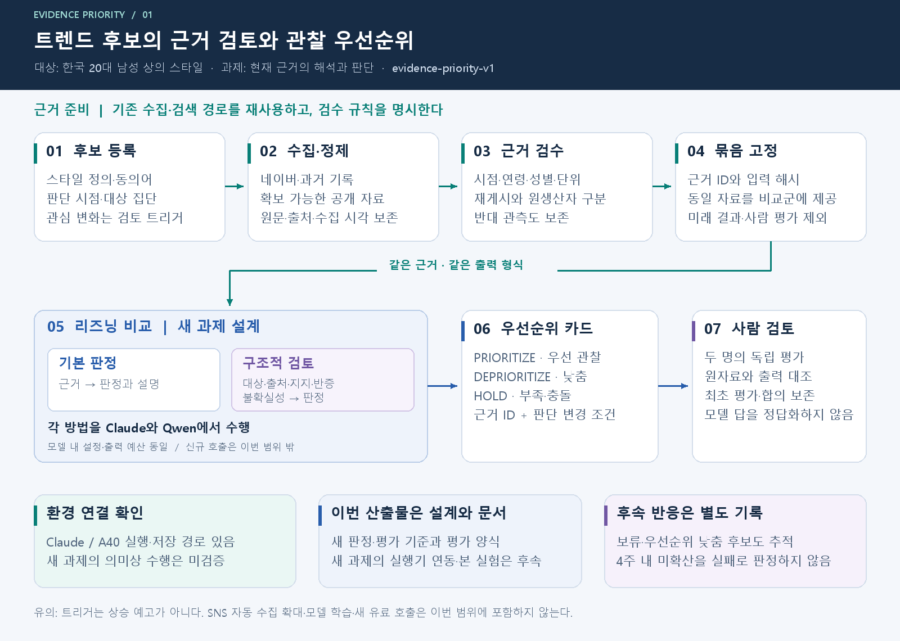
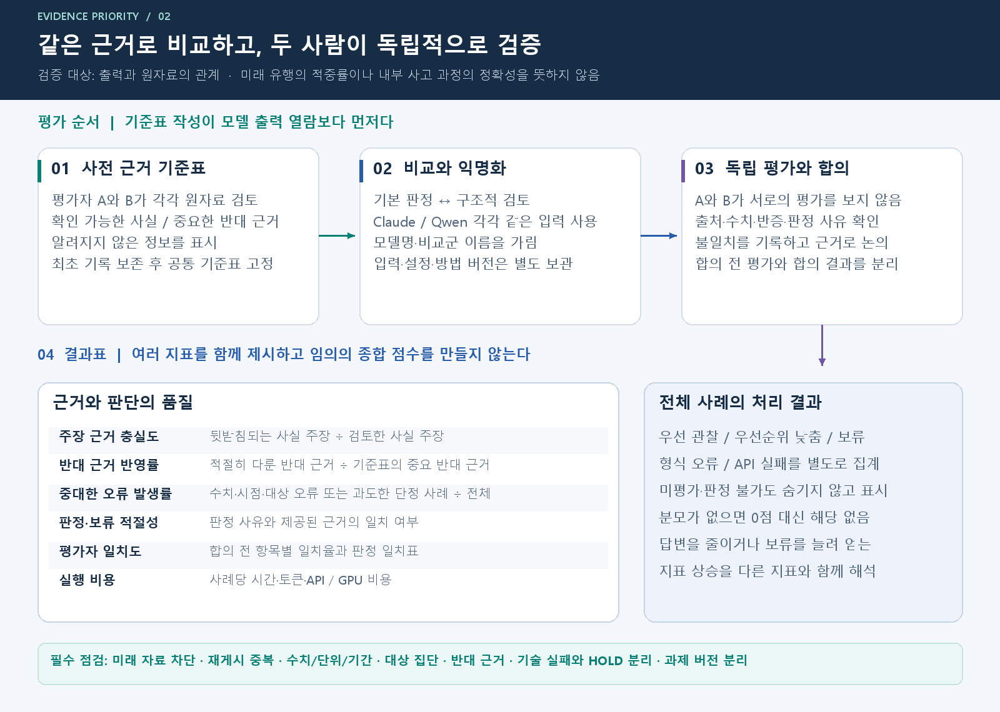

# 근거 기반 관찰 우선순위 구조도

편집 원본은 [evidence-priority-v1.drawio](evidence-priority-v1.drawio)다. diagrams.net 또는 draw.io에서 열면 **시스템 구조**와 **검증과 사람 평가** 두 페이지를 편집할 수 있다. 도형·텍스트·연결선은 이미지가 아닌 개별 네이티브 요소다.

## 시스템 구조

[SVG 원본 미리보기](priority-architecture.svg)

기존 연결 환경과 새 판정 과제의 설계를 구분했다. 현재 기록으로 새 과제의 실행기 연동이나 모델의 의미상 검증 완료를 주장하지 않는다. 후속 반응 기록은 현재 근거 평가와 분리한다.

## 검증과 사람 평가

[SVG 원본 미리보기](priority-evaluation.svg)

기준표는 모델 출력 열람 전에 작성한다. 평가자별 최초 기록과 합의 결과를 구분하며, 형식 오류·API 실패도 전체 처리 결과에 포함한다.

## 재생성 및 확인

`generate_diagrams.py`는 동일한 좌표·문구 정의로 draw.io XML, SVG, PNG를 생성한다. PNG는 Pillow로 직접 렌더링한 미리보기이며 draw.io 앱의 화면 캡처가 아니다. SVG와 draw.io에는 맑은 고딕을 지정하므로 해당 글꼴이 없는 환경에서는 글꼴 대체로 줄 폭이 달라질 수 있다.

Windows의 맑은 고딕과 Pillow가 있는 Python에서 `python generate_diagrams.py`를 실행한다. 다른 운영체제에서는 스크립트의 `FONT` 경로와 글꼴 파일명을 한글 지원 글꼴로 변경해야 한다. 생성 과정에서 모든 텍스트의 가로 폭과 페이지 경계를 검사한다. 두 PNG의 육안 확인과 draw.io XML의 두 페이지 파싱을 완료했다.
