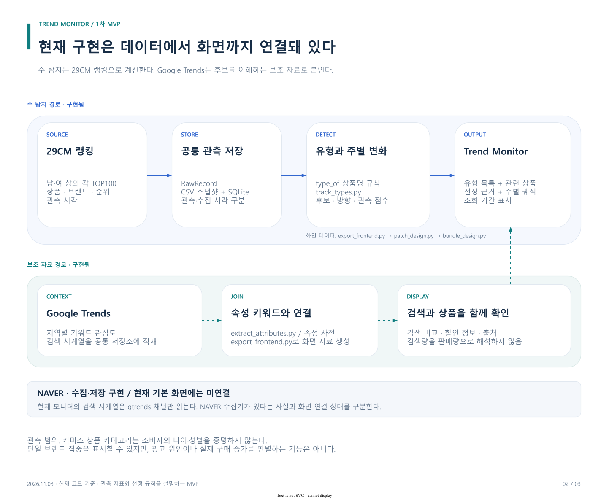

# 1차 MVP 구현 아키텍처

기준: 최신 main `3b8d574`와 이번 PR의 최소 수정. 현재 탐지에 사용되는 경로를 설명한다.

[draw.io 원본](../diagrams/implementation.drawio)

## 구성과 책임

| 단계 | 현재 코드 | 입력 → 출력 | MVP 역할 |
| --- | --- | --- | --- |
| 수집 | src/trend_pipeline/collectors | 소스 응답 → RawRecord | 29CM, NAVER, Google Trends 관측. 기본 화면 검색은 Google Trends만 사용 |
| 저장 | storage.py, snapshots.py, schema.sql | RawRecord → CSV·SQLite signal_raw | 원본과 관측·수집 시점 보존 |
| 자료 복원 | scripts/load_snapshots.py | 저장 CSV → DB | API 키 없이 기존 자료 재현 |
| 속성 연결 | scripts/extract_attributes.py, data/attributes.yml | 상품명 → 속성 목록 | 상품과 검색 키워드 연결 |
| 유형화·화면 데이터 | scripts/export_frontend.py | 랭킹·검색 → P, G, WEEK, TRACK | 상품·검색·시점·추적 데이터 |
| 후보·추적 | scripts/track_types.py | 주간 랭킹 → 상태·궤적·점수 | 상승·분산·다주 변화 |
| 화면 조립 | scripts/patch_design.py, scripts/bundle_design.py | 데이터 + 기존 HTML → 실행 HTML | 기존 Trend Monitor 재사용 |

속성 연결과 유형화는 서로 다르다. 속성은 소재·디테일·품목 등 복수 값을 가지며, 유형은 우선순위가 있는 규칙에서 처음 맞은 분류를 사용한다.

## 데이터 계약

| 데이터 | 핵심 값 | 해석 |
| --- | --- | --- |
| RawRecord | channel, keyword_raw, entity, metric_type, metric_value, observed_at, collected_at, metadata | 소스별 원시 관측 |
| P | 순위, 이전 순위, 브랜드, 상품명, 가격, 의류 성별 분류, 할인율 등 | 속성별 상품 목록; 여러 속성에 같은 상품 등장 가능 |
| G | 검색 시계열, 최근·직전 구간 요약, 마지막 날짜, 선행 계산 결과 | 보조 맥락; 모든 속성에 존재하지 않음 |
| WEEK | 기준·감지·확인 날짜 | 화면의 비교 시점을 통일 |
| TRACK | weeks, verdicts, rises, brands, tops, streak, direction, change, score, parts | 유형별 후보 상태와 관측 요약 |

TRACK.streak는 구간 안 최대 연속 후보 길이다. RawRecord의 시장·고객군 의미는 metadata와 요청 조건에 따라 달라지며, 모든 행이 한국 20대 남성이라고 가정하지 않는다.

현재 화면의 외부 링크는 상품명으로 여는 검색 링크다. 원상품 고유 URL을 직접 연결한 것으로 설명하지 않는다.

기존 export는 LEDGER·CASES·SCORE도 생성한다. 기존 화면과의 호환을 위해 보존하며, 이번 탐지 MVP의 필수 기능·완료 기준에는 넣지 않는다.

## 실행 경계

- 최신 저장 자료에서의 탐지 시연을 기본으로 한다. 과거 시점에서 당시 이용 가능했던 정보만 썼다는 엄격한 회고 재현을 이 실행에 약속하지 않는다.
- 출처별 갱신일이 다르다. 오래된 NAVER 관측을 현재 반응으로 바꾸거나 누락값을 수집된 0으로 표현하지 않는다.
- 29CM 남성·여성 상의 각 TOP100이 기본 입력이다. 상품 분류만으로 구매자의 연령·성별을 알 수 없다.
- 할인·해외 선행은 탐지 근거를 읽는 보조 정보다. 광고 여부나 자연 확산의 확정 근거로 쓰지 않는다.
- 임베딩·벡터 검색은 기존 별도 경로다. 기본 탐지 데모는 사전과 유형 규칙으로 실행한다.
- GitHub 수집 워크플로는 현재 수동 실행이다. 예약 수집이 자동 작동한다고 설명하지 않는다.

## 이번 PR에서 하는 일

기존 탐지 파이프라인과 화면을 기준으로 문서·draw.io·실행 절차를 맞춘다. 빈 DB·빈 색인에서도 안내와 빈 결과로 끝나도록 최소 보완하며, 테스트와 오프라인 재현을 확인한다.

별도 로컬 검증·모델 비교 패키지를 이번 탐지 흐름에 강제로 병합하지 않는다. 기존 작업 폴더의 구현은 보존한다. 추가 앱, 리뷰 폼, 모델 설치나 학습은 만들지 않는다.

