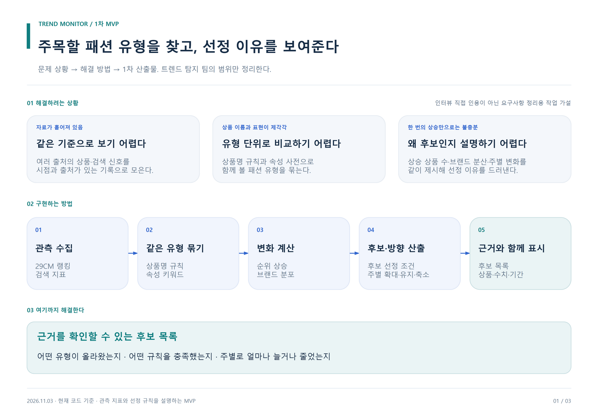
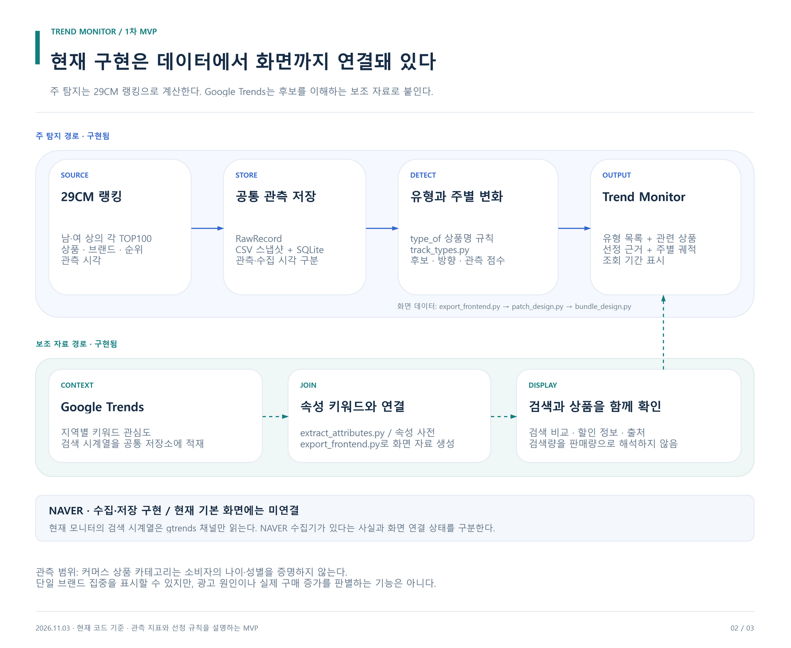
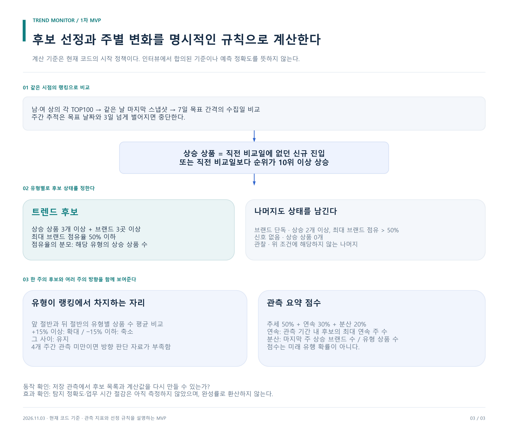

# 패션 트렌드 탐지 · 1차 MVP

**흩어진 패션 신호를 유형별 후보로 모으고, 왜 주목할 만한지 수치와 상품 근거로 보여준다.**

2026-11-03 · 문제 상황 → 해결 방법 → MVP 스펙 → 현재 구현 → 해결 범위

## 01. 해결하려는 상황

상품별 랭킹과 검색 신호가 흩어져 있어 어떤 스타일이 함께 오르는지 파악하기 어렵다. 한 상품·한 브랜드가 급등하거나 원래 큰 카테고리가 반복해서 오르면, 새롭게 확산하는 유형과 비슷하게 보인다.

트렌드 탐지 과제 관련 설명과 팀 보고서로 정리한 작업 문제 정의다. 인터뷰 원문이나 회사가 확정한 합의값으로 인용하지 않는다. 다른 팀 과제는 이번 문서에 포함하지 않는다.

## 02. 해결 방법

[편집 가능한 draw.io 원본](../diagrams/mvp-overview.drawio)

| 문제 | 적용 방법 | 사용자가 확인할 결과 |
| --- | --- | --- |
| 상품과 자료가 흩어져 있음 | 같은 유형·속성으로 묶기 | 유형별 관련 상품 |
| 개별 급등과 유형 확산이 비슷하게 보임 | 상승 상품 수와 브랜드 분산 계산 | 후보 상태와 선정 이유 |
| 큰 카테고리가 늘 후보가 됨 | 여러 주의 유형 상품 수 비교 | 확대·유지·축소 |
| 후보의 근거를 설명하기 어려움 | 시점·상품·계산 결과 연결 | 근거가 보이는 후보 목록 |

## 03. 1차 MVP 스펙

| 항목 | 이번 결정 |
| --- | --- |
| 핵심 기능 | 스타일 유형 후보 탐지와 변화 표시 |
| 입력 | 저장된 29CM 상의 랭킹; Google Trends 검색 자료는 보조 |
| 분석 범위 | 현재 남성·여성 상의 각각 TOP100 |
| 처리 | 같은 시점 선택 → 유형화 → 상승·분산 → 다주 변화 |
| 출력 | 후보 상태, 선정 이유, 관련 상품, 주간 변화, 관측 요약 점수 |
| 완료 기준 | 실제 저장 자료에서 후보와 화면을 재생성하고 이유·누락을 확인 |

현재 화면은 의류 분류를 사용한다. 20대 남성 구매자 반응을 직접 관측하는 시스템으로 설명하지 않는다.

## 04. 어떻게 구현하는가

[편집 가능한 draw.io 원본](../diagrams/implementation.drawio)

새 시스템을 따로 만들지 않고, 최신 저장소의 수집·CSV·SQLite·속성 사전·유형 추적·Trend Monitor를 연결한다.

NAVER 수집·저장 구현은 보유하고 있지만 현재 기본 화면에는 연결돼 있지 않다.

| 단계 | 현재 구현 |
| --- | --- |
| 수집·저장 | trend_pipeline의 collectors, snapshots, storage |
| 상품 속성 | extract_attributes.py + attributes.yml |
| 유형화·화면 데이터 | export_frontend.py |
| 후보·주별 변화 | track_types.py |
| 기존 화면 재사용 | patch_design.py + bundle_design.py |

로컬 검증·모델 비교 구현은 기존 작업 폴더에 보존한다. 이번 탐지 MVP의 필수 경로에 추가하지 않는다.

## 05. 후보를 뽑는 기준

[편집 가능한 draw.io 원본](../diagrams/detection-method.drawio)

- 상승 상품: 이전 비교 스냅샷에 없거나 10위 이상 상승.
- 트렌드 후보: 상승 상품 3개 이상, 브랜드 3개 이상, 최대 브랜드 점유 50% 이하.
- 브랜드 단독: 상승 상품 2개 이상, 최대 브랜드 점유 50% 초과. 광고라는 뜻은 아니다.
- 다주 방향: 랭킹 내 유형 상품 수의 앞·뒤 구간 평균을 비교해 ±15% 기준으로 확대·유지·축소 표시.
- 관측 점수: 추세 50% + 구간 최대 연속 후보 30% + 분산 20%.

이 값은 현재 구현 규칙이다. 인터뷰에서 검증된 기준, 유행 확률, 미래 판매 예측값으로 해석하지 않는다.

## 06. 어느 정도 해결했는가

| 확인 항목 | 이번 실행 결과 | 해석 범위 |
| --- | --- | --- |
| 실제 자료 연결 | 스냅샷 148,677행 재적재 | 저장된 관측의 재현 |
| 상품 속성 연결 | 최신 200개 중 194개 매칭 | 6개 미매칭; 정확도와 다름 |
| 유형별 추적 | 9개 유형, 5개 주간 비교 | 한 주 후보와 다주 변화를 함께 확인 |
| 후보 설명 | 관련 상품·브랜드·주별 수치 연결 | 선정 이유를 따라갈 수 있음 |
| 현업 효과 | 아직 측정하지 않음 | 시간 절감·탐지 정확도는 수치화하지 않음 |

**해결한 부분:** 후보를 자동으로 모으고, 유형별 상승과 선정 이유를 재현한다.

**남는 부분:** 광고·계절성 원인 분리, SNS 관측, 20대 남성 구매자 반응, 실제 판매 연결. 이를 해결했다고 주장하지 않는다.

## 07. 이번 산출물

MVP 스펙 · 실제 코드 연결표 · draw.io 3장 · 기존 구현 실행 안내 · Claude 작업 프롬프트 · PR

추가 리뷰 폼, 다중 모델 비교 연구, 모델 학습, 상품 추천·매입 자동화는 이번 MVP에 포함하지 않는다.

- [통합 문서](README.md)
- [상세 스펙](SPEC.md)
- [실행 안내](LOCAL_RUNBOOK.md)
- [Claude 프롬프트](CLAUDE_PROMPT.md)
- [근거 기록](SOURCES.md)

