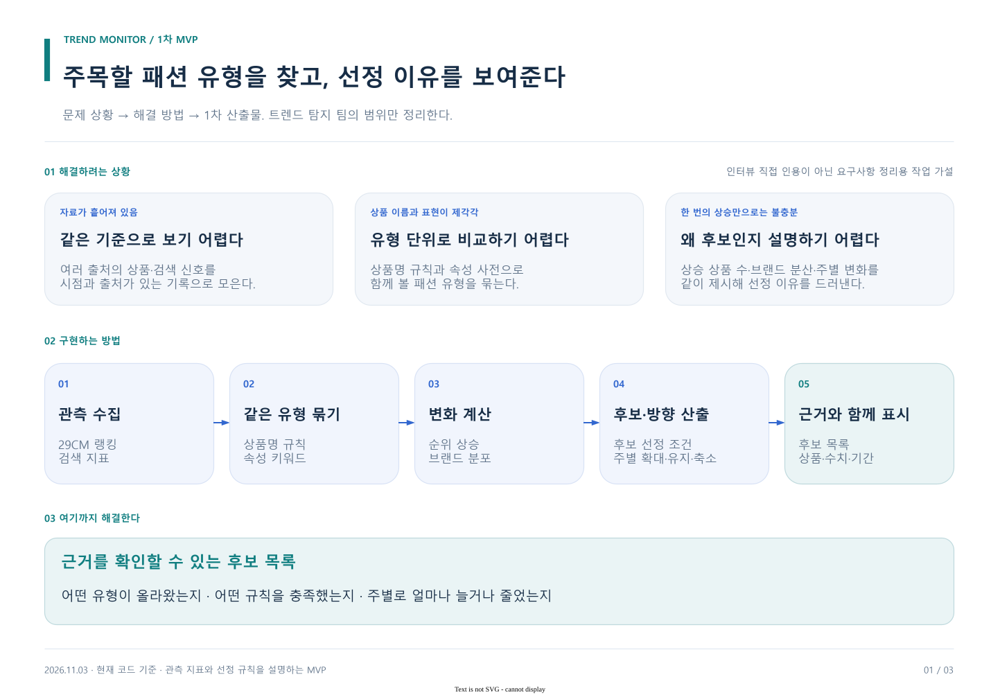

# 패션 트렌드 탐지 · 1차 MVP

**여러 상품에서 함께 나타나는 상승을 스타일 유형으로 묶고, 주목할 후보와 선정 이유를 한 화면에서 확인한다.**

문서 기준: 2026-11-03. 이번 범위는 트렌드 탐지 과제다. 문제 상황, 해결 방법, 현재 구현, 해결 범위, 실행 순서로 읽는다.

## 1. 해결할 상황

상품별 랭킹과 검색 신호가 흩어져 있어 어떤 스타일이 함께 오르는지 파악하기 어렵다. 한 상품·한 브랜드의 급등이나 원래 큰 카테고리의 반복 상승만 보면 새롭게 확산하는 유형과 구분하기도 어렵다.

이는 트렌드 과제 관련 설명과 팀 보고서로 정리한 **작업 문제 정의**다. 인터뷰 원 문답이나 회사의 최종 승인 기준으로 인용하지 않는다. 다른 팀 과제와 이전 쇼핑몰 프로젝트는 포함하지 않는다.

## 2. 해결 방법

[draw.io 원본](../diagrams/mvp-overview.drawio)

| 업무상 어려움 | MVP에서 적용할 방법 | 결과에서 확인할 것 |
| --- | --- | --- |
| 상품마다 표현과 자료가 흩어짐 | 상품명을 속성과 유형으로 묶음 | 후보를 구성하는 상품·브랜드 |
| 단일 상품 급등만으로 유형 확산을 알기 어려움 | 상승 상품 수·브랜드 수·최대 브랜드 점유를 함께 계산 | 후보 선정 기준과 계산값 |
| 원래 큰 유형과 새로 커지는 유형이 비슷하게 보임 | 여러 주의 랭킹 내 유형 상품 수를 비교 | 확대·유지·축소 방향 |
| 후보로 고른 이유를 설명하기 어려움 | 관측 시점·상품명·계산값을 결과와 연결 | 추적 가능한 후보 목록과 상세 |

검색 추이와 해외 선행, 할인은 비교 맥락으로 보여준다. 이 정보만으로 광고를 판별하거나 후보를 자동 탈락시키지 않는다.

## 3. 이번에 고정하는 스펙

- **입력:** 확보된 29CM 상의 랭킹 스냅샷. Google Trends를 보조 검색 신호로 연결한다. NAVER는 기존 수집 자료로 보유하되 기본 화면에는 연결되지 않았다.
- **처리:** 같은 수집 시점 선택 → 상품명 유형화 → 상승·분산 기준 적용 → 다주 변화 계산.
- **출력:** 유형별 후보 상태, 주간 변화, 관측 요약 점수, 관련 상품과 근거.
- **시연 범위:** 현재 수집된 남성·여성 상의 각각 TOP100. 남성복 분류는 20대 남성 구매자 관측을 뜻하지 않는다.
- **완료:** 저장된 실제 자료로 후보 목록과 화면을 재생성하고, 선정 이유·자료 부족을 확인할 수 있다.

사람 리뷰 폼, 모델 간 비교, 학습, 매입·추천 결정, 미래 판매 예측은 이 MVP의 필수 기능이 아니다. 기존 별도 구현을 삭제하거나 전체 통합을 요구하지 않는다.

## 4. 어느 정도 해결했는가

| 항목 | 이번에 확인한 결과 | 남는 한계 |
| --- | --- | --- |
| 자료 연결 | 저장 스냅샷 148,677행 재적재 | 출처별 최신성·고객군이 다름 |
| 상품 묶기 | 최신 상의 200개 중 194개 속성 매칭 | 6개 미매칭; 매칭률은 정확도가 아님 |
| 유형 후보·추적 | 유형 9개, 5개 주간 비교 결과 생성 | 계절성과 노출 원인을 분리하지 못함 |
| 결과 설명 | 상품·브랜드·주별 수치와 연결된 데이터 생성 | 현업 판단 시간 절감은 미측정 |
| 자동 실행 확인 | 363 tests passed | 기능 확인이며 탐지 성능 수치가 아님 |

실행 기준은 최신 main `3b8d574`에서 시작한 이번 작업 브랜치다. 날짜별 스냅샷이 추가되면 수치는 바뀐다. 실행 순서와 검증 환경은 [로컬 실행 안내](LOCAL_RUNBOOK.md)에 남긴다.

## 5. 바로 보기

| 목적 | 문서 |
| --- | --- |
| 포함 기능·규칙·완료 조건 | [MVP 스펙](SPEC.md) |
| 실제 코드와 데이터 연결 | [구현 아키텍처](ARCHITECTURE.md) |
| 기존 구현 재현 | [로컬 실행 안내](LOCAL_RUNBOOK.md) |
| Claude에게 전달 | [작업 프롬프트](CLAUDE_PROMPT.md) |
| 노션에 공유할 본문 | [노션 원고](NOTION.md) |
| 출처와 해석 범위 | [근거 기록](SOURCES.md) |

[팀 노션 문서](https://app.notion.com/p/v1-40c7af36aa5f80efb6ede6be6b236049)

