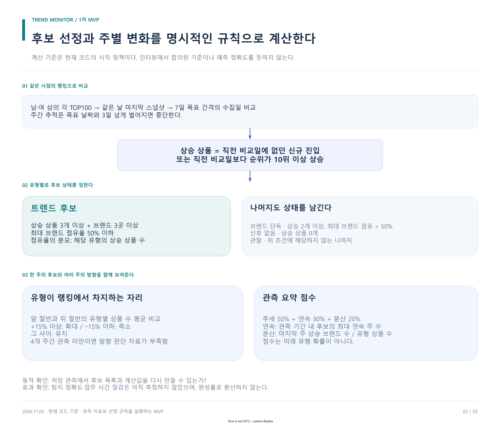

# 1차 MVP 스펙 · 트렌드 탐지

상태: 2026-11-03 작업 기준. 사용자의 최신 범위 지정에 따라 트렌드 탐지에 집중한다. 과거 검증·모델 비교 설계보다 이 범위를 우선한다.

## 해결할 상황과 사용 흐름

사용자는 현재 자료에서 여러 상품·브랜드에 걸쳐 상승하는 스타일을 찾고, 왜 후보로 나왔는지 확인한다. 자료를 하나씩 읽는 대신 **유형 후보 목록 → 주별 변화 → 구성 상품·근거** 순서로 확인한다.

문제 상황은 트렌드 과제 관련 설명과 팀 보고서를 바탕으로 정리했다. 실제 인터뷰 발언의 직접 인용이나 기업 승인 요구사항으로 표기하지 않는다.

## 범위

| 구분 | 1차 MVP 결정 |
| --- | --- |
| 분석 단위 | 상의 상품을 묶은 유형; 상품명 속성은 검색 자료 연결에 사용 |
| 주 탐지 자료 | 29CM 남성·여성 상의 각각 TOP100, 저장된 실제 스냅샷 |
| 보조 자료 | Google Trends 검색 추이, 할인 정보. NAVER 자료는 기본 화면 미연결 |
| 사용자 결과 | 후보 상태, 선정 근거, 주별 변화, 관련 상품, 관측 요약 점수 |
| 실행 방식 | 기존 Python 파이프라인과 Trend Monitor 화면 재사용 |
| 완료 범위 | 자료부터 후보 결과까지 재현; 필수 수치·시점·누락 확인 |
| 제외 | 다른 팀 과제, 추가 리뷰 절차, 다중 모델 비교 연구, 학습, 상품 추천·매입 자동화 |

한국 20~29세 남성이라는 기존 관심 고객군은 유지하되, **현재 탐지 자료가 그 집단을 직접 관측한다고 표시하지 않는다.** 현재 시연은 플랫폼의 남성·여성 의류 분류 범위다. 연령과 구매자 성별을 확인할 자료는 연결되지 않았다.

## 기능과 완료 조건

| ID | 기능 | 완료를 확인하는 방법 | 현재 구현 |
| --- | --- | --- | --- |
| D01 | 자료와 시점 보존 | CSV에서 DB를 재구성하고 관측·수집 시점을 확인 | collectors, snapshots, storage |
| D02 | 같은 시점의 상품 비교 | 각 날짜의 마지막 랭킹 스냅샷 하나만 사용 | export_frontend.ranks_on |
| D03 | 유형·속성 묶기 | 유형과 구성 상품을 확인; 미매칭은 누락 수로 보고 | type_of, extract_attributes |
| D04 | 후보 선정 | 상승 수·브랜드 수·집중도와 상태를 재계산 가능 | track_types.verdict |
| D05 | 다주 변화 | 실제 사용 날짜, 유형 상품 수와 변화 방향 표시 | weekly_chain, build_track |
| D06 | 결과와 근거 연결 | 후보에서 상품·브랜드·주별 수치 확인 | export_frontend, Trend Monitor |
| D07 | 부족한 자료 표시 | 무자료·미매칭·오래된 검색 자료를 성과로 계산하지 않음 | 일부 구현; 화면·로그의 한계 함께 확인 |

D07의 고객군 자동 검증·완전한 결측 통합 표시는 구현 완료로 주장하지 않는다. 현재 자료 범위는 문서와 실행 결과에 명시한다.

## 탐지 방법론 v1

[draw.io 원본](../diagrams/detection-method.drawio)

### 1. 관측 단위를 맞춘다

29CM 남성·여성 상의 TOP100을 같은 수집 시점으로 읽는다. 같은 날 여러 수집을 합치지 않는다. 상품명은 순서가 있는 정규식 유형 규칙과 속성 사전으로 묶는다. 이 경로는 로컬 임베딩 모델 다운로드 없이 실행된다.

### 2. 상승과 분산으로 후보를 찾는다

상승 상품은 직전 비교 스냅샷에 없거나 순위가 10위 이상 오른 상품이다. 신규 진입은 전체 시장의 신상품이라는 뜻이 아니라 이전 관측 집합에 없었다는 뜻이다.

| 조건 | 상태 |
| --- | --- |
| 상승 상품 0개 | 신호 없음 |
| 상승 상품 ≥ 3개, 브랜드 ≥ 3개, 최대 브랜드 점유 ≤ 50% | 트렌드 후보 |
| 상승 상품 ≥ 2개, 최대 브랜드 점유 > 50% | 브랜드 단독 |
| 그 밖 | 관찰 |

분산의 분모는 **해당 유형의 상승 상품 수**다. 브랜드 단독 상태는 광고 판정이 아니다. 다른 브랜드라고 독립적인 캠페인이라고 보장하지도 않는다.

### 3. 한 주의 후보를 여러 주의 변화와 함께 본다

최신 수집일에서 약 7일 간격으로 최대 6개 주간 비교를 만든다. 목표 간격에서 3일 넘게 벗어나면 연결을 끊는다. 실제 날짜를 함께 남긴다.

유형이 각 TOP100에서 차지하는 상품 수의 앞 절반 평균과 뒤 절반 평균을 비교한다. 변화가 +15% 이상이면 확대, −15% 이하면 축소, 그 사이는 유지다. **주당 성장률이 아니다.** 관측점이 4개 미만이면 기존 코드가 유지·0을 반환하므로 안정성이 확인된 것으로 해석하지 않는다.

### 4. 관측 요약을 제공한다

현재 코드의 점수는 추세 50% + 연속 30% + 분산 20%다.

- 추세: 유형 상품 수 변화가 +50% 이상이면 100, +15% 이상이면 70, −15% 초과이면 40, 그 이하면 10.
- 연속: 관측 구간의 **최대 연속 후보 주 수**를 5주 상한으로 환산한다. 현재까지 연속된 주 수와 다르다.
- 분산: 마지막 주 상승 상품의 브랜드 수 ÷ 마지막 주 해당 유형 전체 상품 수를 100점 상한으로 환산한다. 후보 조건의 최대 브랜드 점유와 다른 계산이다.

최종값은 반올림한다. 이 식은 **현재 구현의 관측 요약 규칙**으로 고정하며 인터뷰에서 검증된 산식, 학습된 가중치, 유행 확률로 설명하지 않는다.

## 해결 범위를 확인하는 기준

| 확인 질문 | 측정값/산출물 | 이번 확인 |
| --- | --- | --- |
| 실제 자료를 다시 처리할 수 있는가 | 적재 행 수와 실행 결과 | 148,677행 재적재 |
| 상품이 유형·속성에 연결되는가 | 매칭/미매칭 건수 | 속성 194/200 매칭, 6 미매칭 |
| 후보가 어떤 관측에서 나왔는가 | 날짜별 상승 수·브랜드 분산·유형 개수 | 9유형·5주 결과 |
| 후보 선정 이유를 따라갈 수 있는가 | 계산 규칙과 관련 상품 | 코드·출력 연결 |
| 실무 문제가 얼마나 개선됐는가 | 탐지 정확도·시간 절감 실측 | 아직 측정하지 않음 |

정확도·시간 절감률 목표를 근거 없이 넣지 않는다. 이번 완료는 **후보 선정과 설명을 재현하는 MVP 동작**이며, 광고·계절성 원인 판별이나 미래 수요 예측 완료가 아니다.

